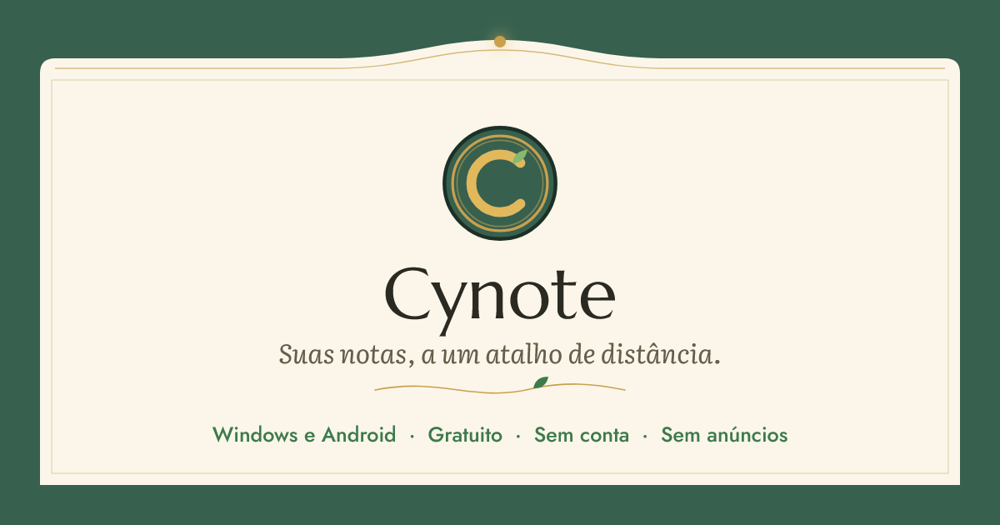

<p align="center">
  <a href="https://cynote.cyberhat.com.br"></a>
</p>

<p align="center">
  <a href="https://github.com/costanoy/Cynote/releases/latest"><b>Baixar para Windows e Android</b></a> · <a href="https://cynote.cyberhat.com.br">Site</a>
</p>

# Cynote

Bloco de notas para Windows e Android. O Cynote fica escondido na bandeja do Windows e aparece na hora com <kbd>Ctrl</kbd>+<kbd>Shift</kbd>+<kbd>Space</kbd>: escreva, feche e siga o dia, que as notas chegam sozinhas ao celular. Gratuito, sem conta e sem anúncios.

## Recursos

- **Sempre à mão**: aparece com <kbd>Ctrl</kbd>+<kbd>Shift</kbd>+<kbd>Space</kbd> de qualquer lugar e pode ficar fixo por cima das outras janelas.
- **Sincroniza sozinho**: no mesmo Wi-Fi, computador e celular trocam as notas sem conta nenhuma. Longe de casa, um código de pareamento liga a sincronização pela nuvem.
- **Editor de verdade**: vários cursores (<kbd>Alt</kbd>+clique e <kbd>Ctrl</kbd>+<kbd>D</kbd>), localizar e substituir (<kbd>Ctrl</kbd>+<kbd>F</kbd> e <kbd>Ctrl</kbd>+<kbd>H</kbd>), ir para a linha (<kbd>Ctrl</kbd>+<kbd>G</kbd>), guias, modo leitura e zoom. Tudo em texto puro.
- **Note Styling**: desenhe à mão por cima da nota, com pena, marca-texto e borracha, e depois arraste, redimensione ou edite o desenho.
- **Dashnotes**: uma janela com todas as notas salvas no computador (`.cyte`, `.txt` e `.md`), organizadas por pastas.
- **Dia e noite**: dois temas, a estufa de manhã e a estufa à noite.
- **Atualiza sozinho** no Windows e no Android.

## Como a sincronização funciona

- **Na rede local**, os aparelhos se encontram sozinhos por mDNS (Bonjour/Zeroconf) e conversam por HTTP, sem servidor externo. Nenhum aparelho é confiável até os dois lados aceitarem o pareamento.
- **Pela nuvem**, um código de pareamento de 80 bits (`4F2A9-C81D0-77B3E-0A1C5`) dá acesso ao espaço daquele par de aparelhos no Firebase Realtime Database. As regras do banco não deixam listar os códigos, só quem tem o código lê ou escreve.
- **O merge nunca sobrescreve em silêncio**: se a mesma nota mudar em dois aparelhos ao mesmo tempo, as duas versões ficam, uma delas com o nome do outro aparelho. O mesmo protocolo foi implementado em Rust (desktop) e em Dart (celular), com testes para os casos delicados, como eco de alterações e cópias repetidas.

## Estrutura

| Pasta | O que tem |
|---|---|
| `desktop/` | App de Windows: Tauri 2 (Rust) + React 19 + TypeScript + Vite |
| `mobile/` | App de Android: Flutter (Dart) |
| `docs/` | Site [cynote.cyberhat.com.br](https://cynote.cyberhat.com.br) |
| `brand-assets/`, `design_handoff_cynote_art_nouveau/` | Identidade visual e o handoff de design que deu origem aos apps |
| `video/` | Vídeo de divulgação |

## Rodando

**Desktop** (precisa de Node.js e do [Rust](https://www.rust-lang.org/tools/install)):

```bash
cd desktop
npm install
npm run tauri dev     # abre o app em modo de desenvolvimento
npm test              # testes (Vitest)
npm run tauri build   # gera o instalador
```

**Celular** (precisa do [Flutter](https://docs.flutter.dev/get-started/install)):

```bash
cd mobile
flutter pub get
flutter run           # roda no aparelho ou emulador conectado
flutter test
```

---

Feito por [Vinícius Costa Magalhães](https://portfolio.cyberhat.com.br) · [Cyberhat](https://cyberhat.com.br)
