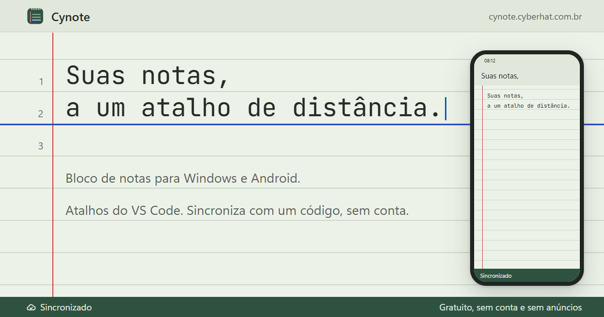

<p align="center">
  <a href="https://cynote.cyberhat.com.br"></a>
</p>

<p align="center">
  <a href="https://github.com/costanoy/Cynote/releases/latest"><b>Baixar para Windows e Android</b></a> · <a href="https://cynote.cyberhat.com.br">Site</a>
</p>

# Cynote

Bloco de notas para Windows e Android. O Cynote fica escondido na bandeja do Windows e aparece na hora com <kbd>Ctrl</kbd>+<kbd>Shift</kbd>+<kbd>Space</kbd>: escreva, feche e siga o dia, que as notas chegam sozinhas ao celular. Gratuito, sem conta e sem anúncios.

## Recursos

- **Sempre à mão**: aparece com <kbd>Ctrl</kbd>+<kbd>Shift</kbd>+<kbd>Space</kbd> de qualquer lugar e pode ficar fixo por cima das outras janelas.
- **Edição do VS Code**: vários cursores (<kbd>Alt</kbd>+clique, <kbd>Ctrl</kbd>+<kbd>Alt</kbd>+<kbd>↑</kbd>/<kbd>↓</kbd>), <kbd>Ctrl</kbd>+<kbd>D</kbd> e <kbd>Ctrl</kbd>+<kbd>Shift</kbd>+<kbd>L</kbd>, seleção em coluna, mover e duplicar linhas (<kbd>Alt</kbd>/<kbd>Shift</kbd>+<kbd>Alt</kbd>+<kbd>↑</kbd>/<kbd>↓</kbd>), localizar e substituir, ir para a linha, quebra de linha (<kbd>Alt</kbd>+<kbd>Z</kbd>), números de linha e zoom. O editor é o CodeMirror 6, e o texto continua puro.
- **Folha pautada**: cada linha tem exatamente a mesma altura e assenta numa pauta; a pauta da linha do cursor fica azul.
- **Sincroniza sozinho**: com o mesmo código no computador e no celular, as notas ficam iguais pela internet, sem conta.
- **Desenho na nota**: caneta, marca-texto e borracha por cima do texto; depois dá para arrastar, redimensionar ou editar o desenho.
- **Dashnotes**: uma janela com todas as notas salvas no computador (`.cyte`, `.txt` e `.md`), organizadas por pastas.
- **Claro e escuro**, com o mesmo bloco nos dois aparelhos.
- **Atualiza sozinho** no Windows e no Android.

## Como a sincronização funciona

- Um código de 80 bits (`4F2A9-C81D0-77B3E-0A1C5`), criado em qualquer um dos aparelhos e digitado no outro, abre o mesmo caderno no Firebase Realtime Database. As regras do banco não deixam listar os códigos: só quem tem o código lê ou escreve.
- Cada nota é uma entrada própria. Criar, editar e apagar chega ao outro aparelho; uma edição sempre ganha de uma exclusão.
- Se a mesma nota mudar nos dois aparelhos antes de sincronizar, fica a edição mais recente, e o texto do outro lado vira uma nota "(conflito)" só quando tem linhas que não estão na versão que ficou.
- A sincronização roda ao abrir, ao mostrar a janela, depois de salvar e a cada 30 segundos com o app aberto. Com a janela escondida, nada roda. Os erros aparecem na barra de status.
- A mesma regra está em TypeScript (`desktop/src/sync/reconcile.ts`) e em Dart (`mobile/lib/sync/reconcile.dart`); as duas passam pelos mesmos casos (`sync-spec/vectors.json`) e por um teste ponta a ponta no emulador do Firebase (`sync-spec/e2e/`). Detalhes em [SYNC.md](SYNC.md).
- As regras do banco estão em `firebase/database.rules.json`. Para publicar: `firebase deploy --only database` dentro de `firebase/`, ou cole o arquivo no console do Firebase (Realtime Database, Regras).

## Estrutura

| Pasta | O que tem |
|---|---|
| `desktop/` | App de Windows: Tauri 2 (Rust) + React 19 + TypeScript + Vite |
| `mobile/` | App de Android: Flutter (Dart) |
| `docs/` | Site [cynote.cyberhat.com.br](https://cynote.cyberhat.com.br) |
| `brand-assets/`, `design_handoff_cynote_art_nouveau/` | Identidade visual e o handoff de design que deu origem aos apps |
| `video/` | Vídeo de divulgação |

## Rodando

**Desktop** (precisa de Node.js e do [Rust](https://www.rust-lang.org/tools/install)):

```bash
cd desktop
npm install
npm run tauri dev     # abre o app em modo de desenvolvimento
npm test              # testes (Vitest)
npm run tauri build   # gera o instalador
```

**Celular** (precisa do [Flutter](https://docs.flutter.dev/get-started/install)):

```bash
cd mobile
flutter pub get
flutter run           # roda no aparelho ou emulador conectado
flutter test
```

---

Feito por [Vinícius Costa Magalhães](https://portfolio.cyberhat.com.br) · [Cyberhat](https://cyberhat.com.br)
